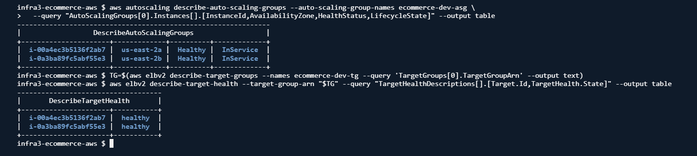
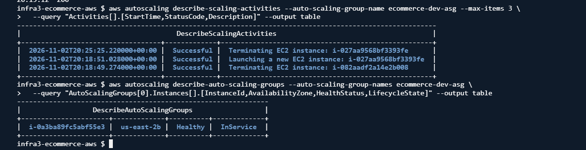

# TechShop — Plataforma e-commerce en AWS con infraestructura como código

Proyecto final de **Infraestructura III — Universidad Icesi (2026)**.
Aplicación de comercio electrónico (Node.js/Express + PostgreSQL) desplegada en AWS, con toda la infraestructura definida en **AWS CloudFormation** y un flujo de **CI/CD en GitHub Actions**.


---

## Qué demuestra este proyecto

- **Infraestructura como código modular:** 5 stacks de CloudFormation desacoplados mediante *exports/imports* (red, seguridad, base de datos, cómputo y monitoreo).
- **Red segmentada:** VPC con subredes públicas y privadas en dos zonas de disponibilidad, Internet Gateway, NAT Gateway y Bastion Host opcional.
- **Alta disponibilidad en la capa de aplicación:** Auto Scaling Group con Launch Template, una instancia por zona de disponibilidad y escalamiento automático por CPU (target tracking, mínimo 2 y máximo 3 instancias) detrás del Application Load Balancer.
- **Base de datos gestionada:** PostgreSQL 15 en Amazon RDS, ubicada en subredes privadas y accesible solo desde la capa de aplicación.
- **Observabilidad:** alarmas de CloudWatch (CPU de EC2 y RDS, errores 5XX y latencia del ALB), notificaciones por SNS y grupos de logs.
- **CI/CD:** cada push y pull request ejecuta las pruebas del backend (Jest + Supertest) contra un PostgreSQL efímero y valida los templates; el despliegue actualiza el stack y reemplaza las instancias sin cortar el servicio (*instance refresh*).
- **Backend con buenas prácticas:** autenticación JWT con refresh tokens, Helmet, limitación de peticiones, validación de entradas, migraciones con Sequelize y logs con Winston.

## Arquitectura

```
                         Internet
                            │
┌───────────────────────────┼──────────────────────────────┐
│ VPC 10.0.0.0/16           ▼                              │
│                                                          │
│  Subredes públicas (10.0.1.0/24, 10.0.2.0/24)            │
│   ┌──────────────────────────┐   ┌──────────────┐        │
│   │ Application Load Balancer│   │ Bastion Host │        │
│   │ health check: /health    │   └──────────────┘        │
│   └────────────┬─────────────┘     NAT Gateway           │
│                │                                         │
│  Subredes privadas (10.0.10.0/24, 10.0.20.0/24)          │
│   ┌────────────▼─────────────────────────────┐           │
│   │ Auto Scaling Group (2–3, target CPU 50%) │           │
│   │  EC2 AZ-a          EC2 AZ-b              │           │
│   │  Node.js + PM2     Node.js + PM2         │           │
│   └────────────┬─────────────────────────────┘           │
│   ┌────────────▼─────────────┐                           │
│   │ RDS PostgreSQL 15        │                           │
│   └──────────────────────────┘                           │
└──────────────────────────────────────────────────────────┘
        CloudWatch · SNS · Systems Manager
```

## Evidencia del despliegue

Desplegado el 2 de noviembre de 2026 en `us-east-2` con `scripts/cloudshell-bootstrap.sh` (5 stacks en `CREATE_COMPLETE`).

**Auto Scaling Group en dos zonas de disponibilidad, ambas instancias sanas en el ALB:**



**Prueba de failover:** se terminó a mano la instancia de `us-east-2a` mientras se consultaba `/health` cada 5 s. El ALB siguió respondiendo (23 de 24 peticiones con `200`, una sola sin respuesta durante ~5-10 s) y el ASG lanzó la instancia de reemplazo 2 segundos después. Detalle en [`docs/evidence/failover-test.txt`](docs/evidence/failover-test.txt).



La misma prueba reveló que con `MinSize: 1` la política de target tracking reducía la capacidad a una sola zona cuando no había carga; por eso el mínimo quedó en 2.

### Lecciones del despliegue

- El plan gratuito de AWS rechaza `t2.micro` y retenciones de backup de RDS mayores a 1 día: ambos valores quedaron parametrizados.
- RDS PostgreSQL 15+ exige SSL (`rds.force_ssl = 1`); la configuración de producción del backend lo habilita.
- Las cuentas del registro nuevo de AWS no soportan NAT Gateway: `EnableNatGateway=false` + `AppSubnetType=public` despliega las instancias en subredes públicas con un security group que solo acepta tráfico del ALB.

## Stacks de CloudFormation

| Stack | Recursos principales |
|---|---|
| `network.yaml` | VPC, 4 subredes, Internet Gateway, NAT Gateway, tablas de rutas |
| `security.yaml` | 4 Security Groups (ALB, aplicación, base de datos, bastion), rol IAM, perfil de instancia |
| `database.yaml` | RDS PostgreSQL, DB Subnet Group, parámetros en SSM Parameter Store |
| `compute.yaml` | Application Load Balancer, Target Group, Launch Template (EBS cifrado, IMDSv2), Auto Scaling Group Multi-AZ, política de escalamiento por CPU, Bastion Host opcional |
| `monitoring.yaml` | 5 alarmas de CloudWatch, tópico SNS, grupos de logs |

## CI/CD

| Workflow | Disparador | Qué hace |
|---|---|---|
| `validate.yml` | Push y pull request a `main`/`dev` | Instala dependencias y ejecuta las pruebas con Jest contra un servicio PostgreSQL 15 |
| `deploy.yml` | Manual (*Run workflow*) | Reutiliza `validate.yml`, despliega el stack de cómputo y ejecuta un *instance refresh* del ASG; verifica el health check del ALB |

## Stack tecnológico

| Capa | Tecnología |
|---|---|
| Infraestructura | AWS CloudFormation, VPC, EC2, ALB, RDS, CloudWatch, SNS, SSM |
| Backend | Node.js 20, Express 4, Sequelize 6, JWT, Helmet, Winston, PM2 |
| Base de datos | PostgreSQL 15 |
| Frontend | HTML5, CSS3, JavaScript, jQuery |
| Pruebas y CI/CD | Jest, Supertest, GitHub Actions |

## Despliegue

Requisitos: AWS CLI con credenciales (probado en AWS Academy Learner Lab), `jq`, Git y Node.js 20+.

```bash
# 1. Copiar y completar los parámetros (contraseñas, secretos JWT, correo para alertas)
cp cloudformation/parameters/dev.json cloudformation/parameters/my-dev.json

# 2. Desplegar los 5 stacks en orden
./scripts/master-deploy.sh --env dev --params cloudformation/parameters/my-dev.json

# 3. Validar recursos y salud de la aplicación
ENV=dev PROJECT=ecommerce REGION=us-east-1 ./scripts/validate-infra.sh
./scripts/healthcheck.sh http://<ALB-DNS-NAME>
```

Guía completa, referencia de la API y solución de problemas en [`docs/`](docs/README.md).

## Estructura

```
backend/          API REST (controladores, modelos, rutas, middleware, pruebas)
frontend/public/  Catálogo, carrito, checkout y panel de administración
cloudformation/   5 stacks + parámetros
scripts/          Despliegue, validación, health check y destrucción
.github/workflows Validación y despliegue
docs/             Guía de despliegue, API, troubleshooting
```

## Próximos pasos

- Restringir el CIDR de acceso al Bastion Host.
- RDS Multi-AZ (deshabilitado por los límites del sandbox de AWS Academy).
- Certificado del bundle de CA de RDS para validar la conexión TLS a la base de datos.

---

**Autor:** Jose Fernando Guerrero Mosquera · [LinkedIn](http://www.linkedin.com/in/joseguerrero2003) · [GitHub](https://github.com/joseGuerrero2003)
